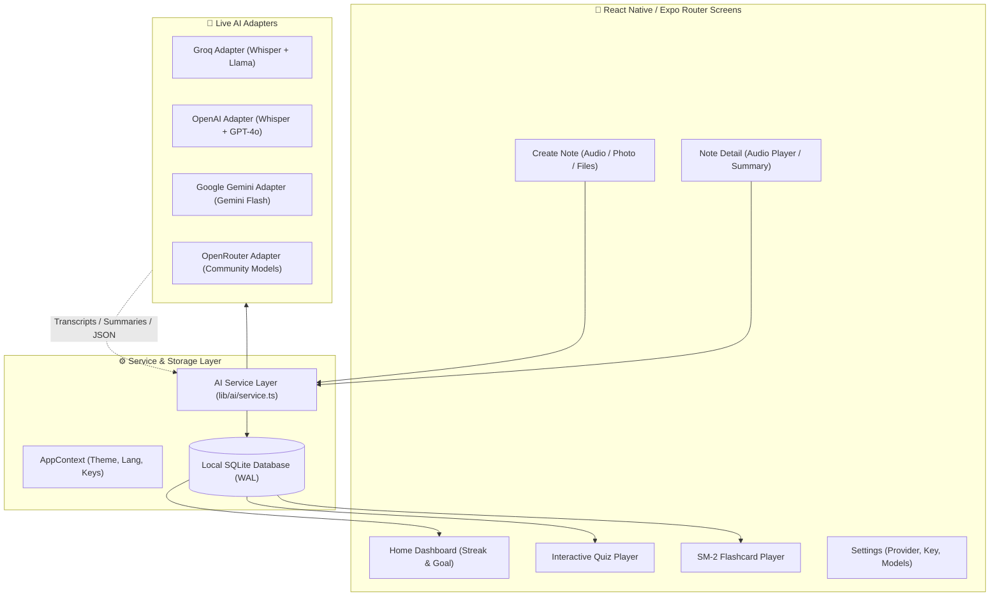

<div align="center">

# 🎓 StudyMate AI

### Free, Open-Source & Local-First AI Study Companion for Students

Turn voice lecture recordings and photo notes into instant **transcripts, summaries, interactive quizzes, and spaced-repetition flashcards** — 100% locally on your phone.

[](https://opensource.org/licenses/MIT)
[](https://expo.dev)
[](https://reactnative.dev)
[](https://www.typescriptlang.org/)
[](CONTRIBUTING.md)
[](https://expo.dev)

<br/>

[Features](#-key-features) •
[Quick Start](#-quick-start-in-60-seconds) •
[Architecture](#-architecture) •
[100% Free AI Setup](#-100-free-ai-options) •
[Contributing](#-contributing) •
[License](#-license)

</div>

---

## 🌟 Why StudyMate AI?

Most AI education tools lock students behind expensive $20/month subscriptions, send personal study notes to unknown cloud servers, or flood the interface with ads. 

**StudyMate AI is different:**
- 🔒 **Local-First & Private:** Your notes, voice recordings, quizzes, and cards stay on your device in a high-speed SQLite database.
- ⚡ **Zero-Subscription:** Bring your own free API key (like Groq or Google Gemini Free Tier) and study completely for free.
- 🧠 **Science-Backed Learning:** Active recall with auto-generated multiple-choice quizzes and spaced-repetition flashcards powered by the SM-2 algorithm.
- 📱 **Sleek Night-Study Theme:** Designed with a distraction-free, focused dark mode aesthetic (Inter font, amber & teal accents).

---

## ✨ Key Features

| Feature | Description | Powered By |
|---|---|---|
| 🎙️ **Audio Lecture Recording** | Record lectures with a live waveform timer and transcribe speech with zero hallucination. | `expo-audio` + Whisper STT |
| 📷 **Photo & Document OCR** | Snap handwritten blackboard notes or upload slides from PDF/images to extract clean text. | `expo-image-picker` + Vision AI |
| 📝 **Smart Bullet Summaries** | Summarize 60-minute lectures into 3-5 crystal-clear, high-yield revision bullet points. | LLM Chat Models |
| 🏷️ **Auto AI Tagging** | Automatically generate descriptive titles and 1–5 topic tags for instant search & filtering. | Structured JSON AI Prompts |
| ❓ **Interactive Quizzes** | Test your knowledge with 4-choice questions, instant visual feedback, and score tracking. | Custom Quiz Player |
| 🃏 **Spaced-Repetition Flashcards** | 3D-feel flip flashcards scheduled with SM-2-lite (Due dates, Ease Factors, Interval growth). | Local SM-2 Scheduler |
| 📊 **Study Habit Dashboard** | Track your daily study streak, review goals with an interactive stepper, and see recent notes. | Local-First SQLite Analytics |
| 🌐 **Full Multi-Language (i18n)** | Seamlessly switch between English and Turkish out of the box. Easy to add any language. | `react-i18next` |

---

## 🏗️ Architecture

StudyMate AI is designed with clean separation of concerns and an extensible provider adapter pattern:



---

## 🚀 Quick Start in 60 Seconds

### 1. Clone & Install
```bash
git clone https://github.com/Mammetbay/study-mate-ai.git
cd study-mate-ai
npm install
```

### 2. Run the App
```bash
npx expo start
```
- Press <kbd>i</kbd> to launch in iOS Simulator
- Press <kbd>a</kbd> to launch in Android Emulator
- Or scan the QR code with **Expo Go** on your physical iOS/Android phone!

### 3. Verify Type Safety
```bash
npx tsc --noEmit
```

---

## 🎁 100% Free AI Options (For Students)

StudyMate AI does not require paid AI accounts! You can use these generous free tiers:

1. **Groq Cloud (Recommended for Speed & STT):**
   - ⚡ Ultra-fast Whisper speech-to-text + Llama 3 models.
   - **Cost:** Free tier available with no credit card required.
   - **Get Key:** [console.groq.com/keys](https://console.groq.com/keys)
2. **Google Gemini (Recommended for Vision OCR & Chat):**
   - 🧠 Free tier for Gemini 1.5/2.0 Flash models with generous rate limits.
   - **Get Key:** [aistudio.google.com/app/apikey](https://aistudio.google.com/app/apikey)
3. **OpenRouter:**
   - 🌐 Free community models (e.g., Llama 3, Mistral, Qwen) accessible with a public catalog.
   - **Get Key:** [openrouter.ai/keys](https://openrouter.ai/keys)

> **No Hardcoded Keys:** Your API key is stored securely in your device's encrypted `AsyncStorage` and sent directly to the AI provider. It is never logged or routed through any proxy server.

---

## 📂 Project Structure

```
studymate-ai/
├── app/                     # Expo Router screens & tab navigation
│   ├── (onboarding)/        # 3-slide welcoming onboarding
│   ├── (tabs)/              # Home, Notes, Quiz, Settings
│   ├── create-note.tsx      # Audio recording & camera/file OCR
│   ├── note/[id].tsx        # Note view, audio player, AI actions
│   ├── quiz/[id].tsx        # Multiple-choice quiz player & score
│   ├── flashcard/[id].tsx   # Spaced repetition flashcard session
│   └── weekly-goal.tsx      # Interactive goal stepper
├── components/
│   ├── study/               # AudioPlayerCard & learning components
│   └── ui/                  # Button, Card, Input, EmptyState, etc.
├── lib/
│   ├── ai/                  # Multi-provider adapter system
│   │   ├── providers/       # Groq, OpenAI, Gemini, OpenRouter adapters
│   │   ├── service.ts       # transcribeAudio, extractText, generateSummary...
│   │   ├── prompts.ts       # Robust zero-shot education prompts
│   │   └── utils.ts         # Hallucination & JSON cleaning utilities
│   ├── db.ts                # Versioned SQLite migrations & queries
│   ├── spacedRepetition.ts  # SM-2-lite algorithm implementation
│   ├── AppContext.tsx       # Global state (theme, language, AI settings)
│   └── theme.ts             # Obsidian Dark & Light design tokens
├── config/
│   ├── languages.ts         # Single source of truth for supported languages
│   └── providers.ts         # Static AI provider endpoints metadata
├── locales/                 # i18n JSON files (en.json, tr.json)
└── types/                   # TypeScript interfaces (Note, Quiz, Flashcard, AI)
```

---

## 🤝 Contributing

We welcome contributions from students, teachers, and developers around the world!

- 🐛 **Found a bug?** Open an [Issue](https://github.com/Mammetbay/study-mate-ai/issues).
- 💡 **Have a feature idea?** Start a discussion or submit a feature request.
- 🌍 **Speak another language?** Adding a new language is as easy as adding one file to `locales/`! See [CONTRIBUTING.md](CONTRIBUTING.md).

Please read our [Code of Conduct](CODE_OF_CONDUCT.md) before participating.

---

## ⭐ Star History

If StudyMate AI helps your studies or you find this open-source project inspiring, please consider giving it a ⭐ on GitHub! It helps more students find and benefit from it.

---

## 📄 License

Distributed under the **MIT License**. See [`LICENSE`](LICENSE) for more information.
Free for personal, academic, and commercial use.
